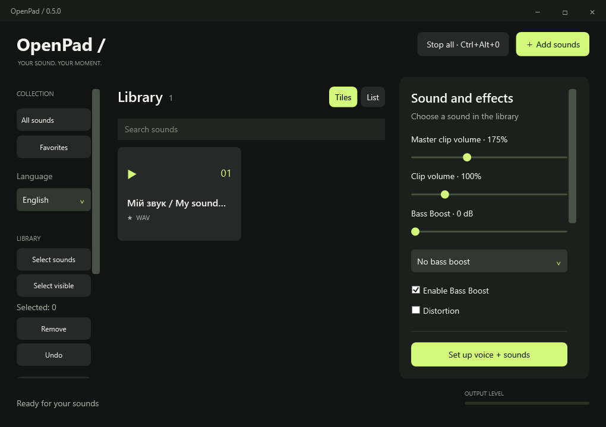

# OpenPad

[Русский](README.md) · **English** · [Українська](README.uk.md)

An open-source Windows soundboard: send clips and your microphone to Discord, play Ogg Vorbis / Opus, apply up to 500% gain and boost the bass.



## Who made this?

**OpenPad is vibe-coded. ChatGPT / OpenAI Codex (AI) created the technical implementation.** Most of the code, interface, audio engine, installer and documentation were written by AI. Repository owner [dimaveng](https://github.com/dimaveng) provided the idea and requirements, tested the application and gave feedback, with almost no direct coding involvement.

This is an independent experimental project, not an official OpenAI product. Crediting AI describes the development process, not legal copyright ownership. AI-generated code still needs normal engineering review; vibe coding is not a quality guarantee.

## Features

- **Tiles and list views**, with a saved view preference.
- Dark window chrome, scrollbars, sliders and meters. Window controls have no colored backgrounds.
- Drag-and-drop import, search and favorites.
- MP3, WAV, Ogg Vorbis and Ogg Opus; additional formats depend on Windows decoders.
- Master clip gain and per-clip gain from 0–500%, applied sequentially.
- Bass Boost from 0–24 dB and optional distortion.
- Microphone plus clips through VB-CABLE, independent voice gain and a live level meter.
- Headphone monitoring of clips without monitoring your own voice.
- Ctrl+Alt+1…9 trigger the first nine clips; Ctrl+Alt+0 stops clips without stopping the microphone.

## Install

Requires Windows x64 and .NET Desktop Runtime 10. Sending audio to Discord requires [VB-CABLE](https://vb-audio.com/Cable/).

Installers and corresponding source archives are available from [GitHub Releases](https://github.com/dimaveng/OpenPad/releases). Check the version in the OpenPad title and SHA256SUMS.txt. A successful vX.Y.Z tag build, or a manual Windows build on main with release_tag, publishes the release.

Run `OpenPad-Setup.exe` and click the install button. OpenPad is embedded in the installer. Missing .NET and VB-CABLE dependencies are downloaded from their official publishers and checksum-verified. Click **Install Driver** in the VB-CABLE window and confirm the Windows elevation prompt. Restart Windows if the driver requires it.

OpenPad installs into `%LOCALAPPDATA%\Programs\OpenPad` and adds a Start Menu shortcut. Installing .NET and the driver may require administrator rights. Reinstallation updates application files while preserving `Data`; close OpenPad before updating.

## Portable and updates

Starting with 0.7 builds, `OpenPad-portable-win-x64.zip` includes .NET. Extract the entire ZIP into a writable folder and run `OpenPad.exe`. New sounds are copied into `Data/Sounds`, OPL packages into `Data/Imports`; library/settings use relative internal paths. Close OpenPad before moving the complete folder. Export/import an `.opl` to bring a library from the installed edition.

VB-CABLE is a system driver and needs a one-time installation on each computer for Discord routing. Portable does not install it automatically; the ZIP contains a link and instructions. Existing VB-CABLE installations work with both editions.

Use **Updates** in the sidebar. Startup checks can be disabled. Downloads start on request; installation asks before closing OpenPad, checks length/SHA-256, preserves `Data` and rolls back file-copy failures. Each edition uses its own update ZIP. [Update details](docs/UPDATES.md). The first upgrade from 0.6.0 requires a new installer because that version has no updater.

## Discord: voice and clips

The interface is available in Ukrainian, English and Russian.

1. Click **Set up voice + sounds** in the bottom routing panel.
2. Select your physical microphone and enable **Send my voice to Discord**.
3. Select **CABLE Input** as the OpenPad output and **CABLE Output** as the Discord input.
4. Keep OpenPad running: it mixes the microphone and clips.
5. If Discord suppresses clips, review its noise suppression and input sensitivity settings.

Clip gain does not affect voice gain. Distortion processes the combined output. Stop All only stops clips.

## OPL packages and multiple selection

Import .opl adds a collection with embedded audio. Export includes the whole library or selected clips. Click “Select sounds” or Ctrl+click to select multiple items; “Select visible” respects search and favorites. “Remove” removes library entries while keeping audio files. Undo restores the last removal until the app closes. See the [OPL format and limits](docs/OPL.md).

## Language

The Language selector is at the bottom of the left sidebar. Ukrainian, English and Russian switch live, and your choice is saved. On first start or migration from settings without a language, the Windows display language is used: uk → Ukrainian, ru → Russian, all others → English. Clip names and device names remain unchanged. OS dialogs and system error details may follow the Windows language. The installer UI also follows Windows; technical installation logs remain in English.

## Library and data

Settings live in `Data/library.json` next to the application. The installed edition keeps original audio paths; portable copies new sounds into `Data`. Use `.opl` to move a collection between editions. Copying `Data` for an installed edition still requires access to external audio files.

Personal data, audio files and local verification reports are excluded from the repository and installer. Import failures show the affected filename and reason.

## Build

Install [.NET SDK 10](https://dotnet.microsoft.com/download/dotnet/10.0) on Windows.

```powershell
git clone https://github.com/dimaveng/OpenPad.git
cd OpenPad
dotnet restore OpenPad.csproj --locked-mode --configfile NuGet.Config
dotnet publish OpenPad.csproj -c Release --no-restore -o artifacts/app
powershell -NoProfile -File Installer/Build.ps1
```

The installer is generated one directory above the repository: `../OpenPad-Setup.exe`. The build script uses the Windows .NET Framework compiler for the bootstrapper, which runs without .NET 10. Distribute binary builds with their corresponding source and license notices.

## Tests

```powershell
$p = Start-Process ./artifacts/app/OpenPad.exe -ArgumentList '--self-test' -Wait -PassThru
if ($p.ExitCode) { throw 'Audio tests failed' }
$p = Start-Process ./artifacts/app/OpenPad.exe -ArgumentList '--ui-test artifacts/ui-check' -Wait -PassThru
if ($p.ExitCode) { throw 'UI tests failed' }
```

`--self-test` checks sample-rate/channel conversion, gain, bass boost, clip stopping and microphone independence. An optional Ogg path enables full-file decoding checks. `--ui-test` checks view switching, search and persistence, and renders 1240×820 and 1020×720 screenshots using a synthetic library.

Tests do not replace a real Discord call. CI checks compilation and audio logic; visual checks run locally on Windows. Dependency installation on a clean Windows machine has not yet been tested.

## Limitations

No tray mode, autostart, hotkey editor, multiband EQ or custom virtual audio driver yet. Opus supports ordinary mono/stereo streams using channel mapping family 0. Other applications can occupy the hotkeys. Disconnected audio devices must be selected again.

## License

**GNU GPL v3.0 only — GPL-3.0-only.** Commercial use is permitted subject to GPL conditions. See [LICENSE](LICENSE). Dependencies retain their own licenses; see [THIRD-PARTY-NOTICES.md](THIRD-PARTY-NOTICES.md).

[Changelog](CHANGELOG.md) · [Contributing](CONTRIBUTING.md)
