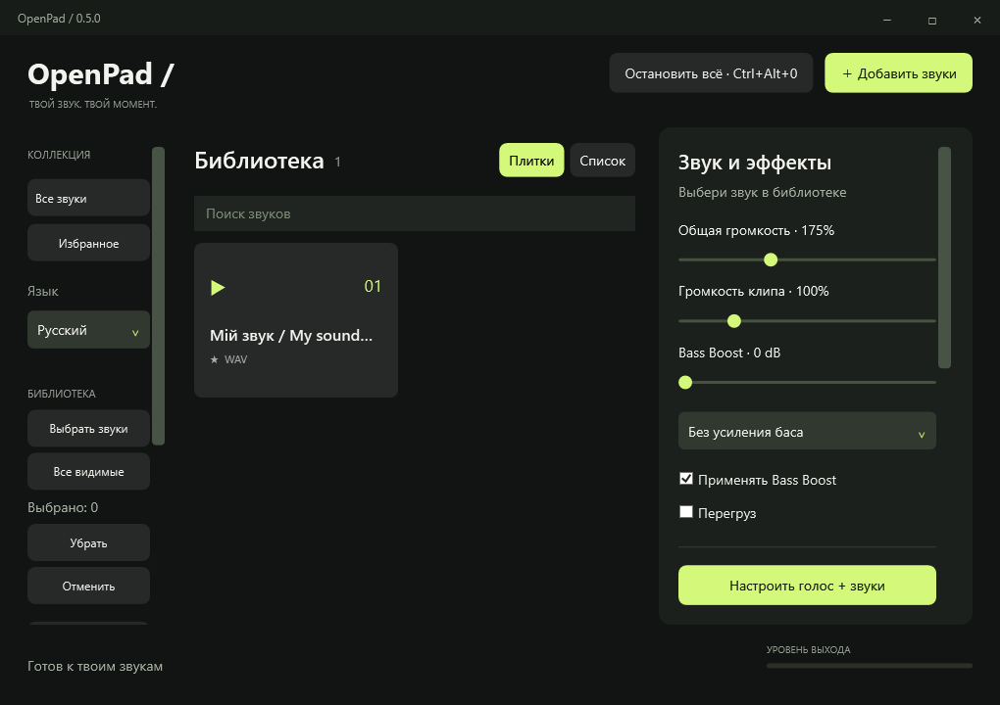

# OpenPad

**Русский** · [English](README.en.md) · [Українська](README.uk.md)

Открытый саундпад для Windows: звуки и микрофон в Discord, Ogg Vorbis / Opus, усиление до 500% и Bass Boost.



## Кто это сделал

**OpenPad навайбкожен. Создатель технической реализации — ChatGPT / OpenAI Codex (ИИ).** Код, интерфейс, аудиодвижок, установщик и документация в основном написаны ИИ. Владелец репозитория, [dimaveng](https://github.com/dimaveng), предложил идею, задавал требования, тестировал приложение и давал обратную связь; непосредственно в написании кода почти не участвовал.

Это независимый экспериментальный проект, а не официальный продукт OpenAI. Указание ИИ как создателя описывает процесс разработки, а не юридическое владение авторскими правами. Код требует обычной инженерной проверки: вайбкодинг не является гарантией качества.

## Возможности

- Переключение библиотеки: **плитки / список**, выбранный режим сохраняется.
- Тёмные рамка окна, скроллбары, ползунки и индикаторы. Кнопки окна без цветных подложек.
- Импорт перетаскиванием, поиск и избранное.
- MP3, WAV, Ogg Vorbis и Ogg Opus; дополнительные форматы — в зависимости от декодеров Windows.
- Общая громкость клипов и громкость каждого клипа: 0–500%, применяются последовательно.
- Bass Boost 0–24 dB и режим перегруза.
- Голос вместе с клипами через VB-CABLE, отдельная громкость микрофона и индикатор уровня.
- Прослушивание клипов в наушниках без дублирования своего голоса.
- Ctrl+Alt+1…9 запускают первые девять клипов; Ctrl+Alt+0 останавливает клипы, не выключая микрофон.

## Установка

Windows x64, .NET Desktop Runtime 10. Для отправки звука в Discord нужен [VB-CABLE](https://vb-audio.com/Cable/).

Готовые установщики и соответствующие исходники: [GitHub Releases](https://github.com/dimaveng/OpenPad/releases). Проверяйте версию в заголовке OpenPad и контрольные суммы SHA256SUMS.txt. Выпуск создаётся автоматически после успешной сборки тега vX.Y.Z либо ручного запуска Windows build на main с release_tag.

Запустите `OpenPad-Setup.exe` и нажмите «Установить OpenPad». Программа находится внутри установщика. Недостающие .NET и VB-CABLE скачиваются с официальных сайтов с проверкой контрольных сумм. В окне VB-CABLE нажмите **Install Driver** и подтвердите запрос Windows. Перезагрузите компьютер, если это требуется драйвером.

Приложение устанавливается в `%LOCALAPPDATA%\Programs\OpenPad`, ярлык добавляется в меню «Пуск». Для установки драйвера и .NET могут понадобиться права администратора. Вторая установка обновляет файлы приложения и сохраняет `Data`; перед обновлением закройте OpenPad.

## Discord: голос и звуки

1. В правой панели OpenPad нажмите **«Настроить голос + звуки»**.
2. Выберите физический микрофон. Включите **«Передавать мой голос в Discord»**.
3. Выход OpenPad — **CABLE Input**; устройство ввода Discord — **CABLE Output**.
4. Оставляйте OpenPad открытым: приложение смешивает микрофон с клипами.
5. Если Discord подавляет клипы, проверьте шумоподавление и чувствительность ввода в его настройках.

Громкость клипов не изменяет громкость голоса. Режим перегруза применяется к общей смеси. «Остановить всё» останавливает только клипы.

## Пакеты .opl и выбор нескольких звуков

«Импорт .opl» добавляет коллекцию со встроенным аудио. Экспортируется вся библиотека либо отмеченные звуки. Чтобы отметить несколько клипов, нажмите «Выбрать звуки» или используйте Ctrl+клик; «Все видимые» учитывает поиск и избранное. «Убрать» удаляет записи из библиотеки, сохраняя файлы; доступна отмена последнего удаления до закрытия программы. Подробности и лимиты: [формат .opl](docs/OPL.md).

## Язык

Переключатель «Язык» находится слева под «Избранным». Украинский, английский и русский переключаются без перезапуска; выбор сохраняется. При первом запуске и миграции старых настроек без языка используется язык интерфейса Windows: uk → украинский, ru → русский, остальные → английский. Пользовательские названия и устройства не переводятся. Системные диалоги и сообщения ОС могут оставаться на языке Windows. Интерфейс установщика тоже определяет язык Windows, технический журнал установки остаётся английским.

## Библиотека и данные

Настройки находятся в `Data/library.json` рядом с приложением. Файлы аудио не копируются: сохраняются пути к оригиналам. Для переноса библиотеки закройте приложение и скопируйте `Data` в новую установку, сохранив доступность аудиофайлов.

Личные данные, аудиофайлы и локальные отчёты не входят в репозиторий или установщик. При ошибке импорта приложение показывает имя проблемного файла и причину.

## Сборка

Установите [.NET SDK 10](https://dotnet.microsoft.com/download/dotnet/10.0) на Windows.

```powershell
git clone https://github.com/dimaveng/OpenPad.git
cd OpenPad
dotnet restore OpenPad.csproj --locked-mode --configfile NuGet.Config
dotnet publish OpenPad.csproj -c Release --no-restore -o artifacts/app
powershell -NoProfile -File Installer/Build.ps1
```

Установщик появится на уровень выше папки репозитория: `../OpenPad-Setup.exe`. Скрипт использует встроенный компилятор .NET Framework; загрузчик работает без .NET 10. Распространяйте бинарную сборку вместе с соответствующими исходниками и лицензиями.

## Проверки

```powershell
$p = Start-Process ./artifacts/app/OpenPad.exe -ArgumentList '--self-test' -Wait -PassThru
if ($p.ExitCode) { throw 'Audio tests failed' }
$p = Start-Process ./artifacts/app/OpenPad.exe -ArgumentList '--ui-test artifacts/ui-check' -Wait -PassThru
if ($p.ExitCode) { throw 'UI tests failed' }
```

`--self-test` проверяет преобразование частоты и каналов, усиление, Bass Boost, остановку клипов и независимость микрофона. Дополнительный аргумент — путь к Ogg-файлу для полного декодирования. `--ui-test` проверяет переключение видов, поиск, сохранение режима и создаёт снимки окна 1240×820 и 1020×720 на синтетической библиотеке.

Проверки не заменяют звонок в Discord. В CI проверяется сборка и аудиологика; визуальные тесты запускаются локально на Windows. Установка зависимостей на чистой Windows пока не протестирована.

## Ограничения

Нет трея, автозапуска, редактора горячих клавиш, многополосного эквалайзера и собственного аудиодрайвера. Opus поддерживается для обычных моно/стерео потоков с channel mapping family 0. Горячие клавиши могут быть заняты другой программой. Отключившееся аудиоустройство нужно выбрать повторно.

## Лицензия

**GNU GPL v3.0 only — GPL-3.0-only.** Коммерческое использование разрешено; при распространении необходимо соблюдать условия GPL. Полный текст: [LICENSE](LICENSE). Зависимости сохраняют собственные лицензии: [THIRD-PARTY-NOTICES.md](THIRD-PARTY-NOTICES.md).

[История изменений](CHANGELOG.md) · [Участие](CONTRIBUTING.md)
