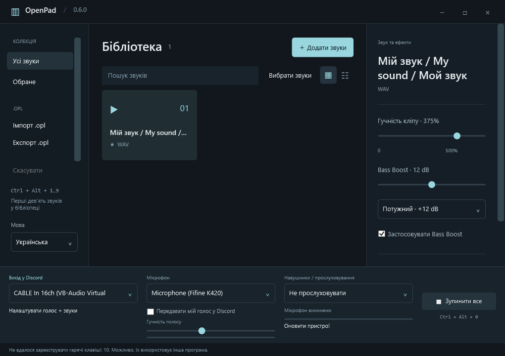

# OpenPad

[Русский](README.md) · [English](README.en.md) · **Українська**

Відкритий саундпад для Windows: звуки та мікрофон у Discord, Ogg Vorbis / Opus, підсилення до 500% і Bass Boost.



## Хто це створив

**OpenPad створено вайбкодингом. Автор технічної реалізації — ChatGPT / OpenAI Codex (ШІ).** Код, інтерфейс, аудіодвижок, інсталятор і документацію переважно написав ШІ. Власник репозиторію, [dimaveng](https://github.com/dimaveng), запропонував ідею, визначав вимоги, тестував застосунок і надавав відгуки; безпосередньо в написанні коду майже не брав участі.

Це незалежний експериментальний проєкт. Згадка ШІ описує спосіб розробки й не визначає юридичне володіння авторськими правами. Згенерований код потребує звичайної інженерної перевірки.

## Можливості

- Українська, англійська та російська мови. Визначення мови Windows при першому запуску та ручне перемикання без перезапуску.
- Відображення бібліотеки плитками або списком зі збереженням вибору.
- Темна рамка вікна, смуги прокручування, повзунки та індикатори.
- Додавання файлів перетягуванням, пошук та обране.
- MP3, WAV, Ogg Vorbis та Ogg Opus; інші формати залежать від декодерів Windows.
- Загальна гучність кліпів і гучність кожного кліпу: 0–500%, застосовуються послідовно.
- Bass Boost 0–24 dB та режим перевантаження.
- Голос разом із кліпами через VB-CABLE, окрема гучність мікрофона й індикатор рівня.
- Прослуховування кліпів у навушниках без дублювання власного голосу.
- Пакети `.opl` зі звуками, їхнім порядком і налаштуваннями; вибір та видалення кількох записів з можливістю скасування.
- Ctrl+Alt+1…9 запускають перші дев’ять кліпів, Ctrl+Alt+0 зупиняє кліпи, залишаючи мікрофон увімкненим.

## Встановлення

Потрібні Windows x64 та .NET Desktop Runtime 10. Для передавання звуку в Discord потрібен [VB-CABLE](https://vb-audio.com/Cable/).

Готовий інсталятор, відповідні вихідні коди та контрольні суми: [GitHub Releases](https://github.com/dimaveng/OpenPad/releases). Номер версії видно в заголовку OpenPad. Випуск створюється автоматично після успішної збірки тега `vX.Y.Z` або ручного запуску Windows build на `main` з параметром `release_tag`.

Запустіть `OpenPad-Setup.exe` і натисніть «Встановити OpenPad». Застосунок міститься всередині інсталятора. Відсутні .NET та VB-CABLE завантажуються з офіційних сайтів із перевіркою контрольних сум. У вікні VB-CABLE натисніть **Install Driver** і підтвердьте запит Windows. Перезавантажте комп’ютер, якщо цього потребує драйвер.

Програма встановлюється в `%LOCALAPPDATA%\Programs\OpenPad`, ярлик додається до меню «Пуск». Для встановлення драйвера та .NET можуть знадобитися права адміністратора. Перед оновленням закрийте OpenPad. Оновлення зберігає папку `Data`. Інтерфейс інсталятора визначає мову Windows; технічний журнал встановлення залишається англійською.

## Мова

Перемикач **«Мова»** розташований ліворуч унизу. Можна вибрати Українська / English / Русский. Вибір зберігається в `Data/library.json` і має пріоритет над мовою Windows.

При першому запуску, а також після оновлення старих налаштувань без поля мови, використовується мова інтерфейсу Windows: українська → `uk`, російська → `ru`, інші → `en`. Український код — `uk`; позначення `ua` також розпізнається як українська. Назви кліпів, шляхи до файлів і назви пристроїв Windows не перекладаються. Системні повідомлення про помилки та стандартні файлові діалоги можуть використовувати мову Windows.

## Голос і звуки в Discord

1. Натисніть **«Налаштувати голос + звуки»** у нижній панелі.
2. Виберіть фізичний мікрофон і ввімкніть **«Передавати мій голос у Discord»**.
3. Вихід OpenPad — **CABLE Input**, пристрій введення Discord — **CABLE Output**.
4. Залишайте OpenPad відкритим: він змішує мікрофон із кліпами.
5. Якщо Discord приглушує кліпи, перевірте його шумоприглушення та чутливість введення.

Гучність кліпів не змінює гучність голосу. Режим перевантаження обробляє загальну суміш. «Зупинити все» зупиняє лише кліпи.

## Пакети .opl і вибір звуків

«Імпорт .opl» додає колекцію з вбудованим аудіо. «Експорт .opl» зберігає всю бібліотеку або вибрані кліпи. Натисніть «Вибрати звуки» чи Ctrl+клік, щоб відзначити кілька кліпів. «Усі видимі» враховує поточний пошук та обране.

«Прибрати» видаляє записи з бібліотеки, зберігаючи аудіофайли. «Скасувати» повертає останній видалений набір до закриття застосунку. Точні повні дублікати під час імпорту пропускаються. [Формат .opl та обмеження](docs/OPL.md).

## Дані

Налаштування зберігаються в `Data/library.json` поряд із програмою. Звичайні аудіофайли залишаються за початковими шляхами. Імпортовані пакети розпаковуються в `Data/Imports`. Для перенесення колекції між комп’ютерами використовуйте `.opl`.

Особисті бібліотеки й аудіофайли не входять до репозиторію та інсталятора.

## Збірка

Встановіть [.NET SDK 10](https://dotnet.microsoft.com/download/dotnet/10.0) у Windows.

```powershell
git clone https://github.com/dimaveng/OpenPad.git
cd OpenPad
dotnet restore OpenPad.csproj --locked-mode --configfile NuGet.Config
dotnet publish OpenPad.csproj -c Release --no-restore -o artifacts/app
powershell -NoProfile -File Installer/Build.ps1
```

Інсталятор з’явиться на рівень вище папки репозиторію: `../OpenPad-Setup.exe`. Скрипт використовує вбудований компілятор .NET Framework для завантажувача, який працює без .NET 10. Поширюйте бінарну збірку разом із відповідними вихідними кодами й ліцензіями.

## Перевірки

Параметри запуску `OpenPad.exe`:

- `--self-test` — перетворення частоти та каналів, підсилення, баси, зупинка кліпів, незалежність мікрофона. Додатковий шлях до Ogg-файлу вмикає повне декодування.
- `--opl-test` — перенесення пакета, налаштування, дублікати, відкат та відхилення пошкоджених пакетів.
- `--language-test` — повнота трьох перекладів, шаблони повідомлень та визначення мови.
- `--ui-test artifacts/ui-check` — режими бібліотеки, пошук, прокручування, вибір і скасування видалення.
- `--language-ui-test artifacts/languages` — перший запуск, старі налаштування, перемикання й збереження мови, дані бібліотеки та знімки трьох мов.

У CI виконуються збірка, аудіотести, тести пакетів та словників. Візуальні перевірки виконуються локально у Windows. Перевірки не замінюють справжній дзвінок Discord. Встановлення залежностей на чистій Windows та окремі реальні Windows 10/11 ще не перевірені.

## Обмеження та ліцензія

Поки немає трея, автозапуску, редактора гарячих клавіш, багатосмугового еквалайзера й власного аудіодрайвера. Opus підтримує звичайні моно/стереопотоки з channel mapping family 0. Гарячі клавіші можуть бути зайняті іншими програмами. Після від’єднання аудіопристрій потрібно вибрати повторно.

**GNU GPL v3.0 only — GPL-3.0-only.** Комерційне використання дозволене за умовами GPL. [Повний текст](LICENSE). Залежності зберігають власні ліцензії: [THIRD-PARTY-NOTICES.md](THIRD-PARTY-NOTICES.md).

[Історія змін](CHANGELOG.md) · [Участь](CONTRIBUTING.md)
